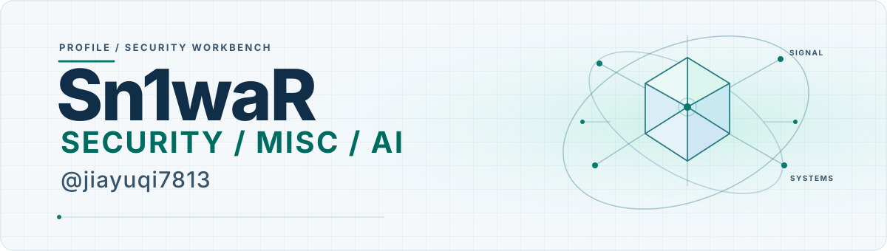

<picture>
  <source media="(prefers-color-scheme: dark)" srcset="./assets/profile-hero-dark.svg">
  
</picture>

## 关于我 · About

**Sn1waR** — 安全开发与 CTF/MISC 实践，持续探索 AI 与实用工具。

**CTFer** · **Security Development Engineer** · **W&M** · **EIMSOUND**

[Website](https://www.snowywar.top) · [BiliBili](https://space.bilibili.com/8389161) · [GitHub](https://github.com/jiayuqi7813)

## 方向 · Focus

- **安全 / MISC** — CTF 挑战、实践工具与 Writeup。
- **AI 探索** — 开源模型与本地实验。
- **实用工具** — 把小想法做成可复用的项目。

## 精选项目 · Selected Projects

| 项目 / Project | 说明 / Description | 技术栈 / Stack |
| --- | --- | --- |
| [goPic](https://github.com/jiayuqi7813/gopic) | 受 Python PIL 启发的图像处理库。 | Go |
| [与雪论题](https://github.com/jiayuqi7813/chal_with_snowy) | 基于字符映射的 AES 文本与文件加解密工具。 | Python |
| [MISC-MCP](https://github.com/jiayuqi7813/misc-mcp) | 自用工具框架的开源版本。 | Python |

## 技术工具箱 · Toolbox

**Languages / 语言**

   

**Framework / 框架**

## 最近文章 · Latest Writing

<!-- BLOG-POST-LIST:START -->
- [随感 1](https://www.snowywar.top/4700.html)
- [个人开发者思路收集汇总内容](https://www.snowywar.top/4693.html)
- [OnlyPwner - SEAL 911 - Writeup](https://www.snowywar.top/4676.html)
- [OnlyPwner - Payday - Writeup](https://www.snowywar.top/4674.html)
- [OnlyPwner - Jump N Run -  Writeup](https://www.snowywar.top/4672.html)
<!-- BLOG-POST-LIST:END -->

## 贡献 · Contributions

[查看 GitHub 贡献记录](https://github.com/jiayuqi7813?tab=overview)

<picture>
  <source media="(prefers-color-scheme: dark)" srcset="https://raw.githubusercontent.com/jiayuqi7813/jiayuqi7813/output/github-contribution-grid-snake-dark.svg">
  <source media="(prefers-color-scheme: light)" srcset="https://raw.githubusercontent.com/jiayuqi7813/jiayuqi7813/output/github-contribution-grid-snake.svg">
  
</picture>

## 欢迎交流

感谢来访，欢迎交流安全、MISC 与工具实践。
