<picture>
  <source media="(prefers-color-scheme: dark)" srcset="./assets/hero-dark.svg">
  
</picture>

 

## 👋 Hi, I'm Sn1waR

- 🚩 **CTFer** @ [W&M](https://github.com/wm-team), focused on **MISC**
- 🛡️ **Security Development Engineer**
- 🤖 Building [**Muteki**](https://github.com/FishCodeTech/muteki), an open-source AI-powered offensive security harness for automated penetration testing
- 🧪 Tinkering with open-model deployment and behavioral interventions on dual DGX Sparks
- 🎧 **EIMSOUND**
- ✍️ Writeups and notes at [snowywar.top](https://www.snowywar.top)

## 🚀 Projects

<table>
  <tr><th colspan="3" align="left">🤖 AI × Security</th></tr>
  <tr>
    <td><a href="https://github.com/FishCodeTech/muteki"><b>Muteki</b></a></td>
    <td>Open-source AI-powered offensive security harness for automated penetration testing</td>
    <td></td>
  </tr>
  <tr>
    <td><a href="https://github.com/jiayuqi7813/DeepSeek-V4-Flash-0731-CRACK-2x-DGX-Spark">DeepSeek-V4-Flash-CRACK</a></td>
    <td>Reproducible refusal-subspace editing and TP=2 deployment on two DGX Sparks</td>
    <td></td>
  </tr>
  <tr>
    <td><a href="https://github.com/jiayuqi7813/crack-open-models-dgx-spark">crack-open-models-dgx-spark</a></td>
    <td>Architecture-first Codex skill for open-model behavioral interventions</td>
    <td></td>
  </tr>
  <tr>
    <td><a href="https://github.com/jiayuqi7813/misc-mcp">misc-mcp</a></td>
    <td>Open-source edition of my personal MISC toolkit, served over MCP</td>
    <td></td>
  </tr>
  <tr><th colspan="3" align="left">🔍 CTF / MISC Tools</th></tr>
  <tr>
    <td><a href="https://github.com/jiayuqi7813/Stegsolve-rs"><b>Stegsolve-rs</b></a></td>
    <td>StegSolve rebuilt in Rust + egui for image steganography analysis, now with MCP support</td>
    <td></td>
  </tr>
  <tr>
    <td><a href="https://github.com/jiayuqi7813/zsteg-rust">zsteg-rust</a></td>
    <td>zsteg rewritten in Rust</td>
    <td></td>
  </tr>
  <tr>
    <td><a href="https://github.com/jiayuqi7813/chal_with_snowy">chal_with_snowy</a></td>
    <td>AES text and file encryption with a custom character mapping</td>
    <td></td>
  </tr>
  <tr>
    <td><a href="https://github.com/jiayuqi7813/gopic">goPic</a></td>
    <td>PIL-inspired image processing library for Go</td>
    <td></td>
  </tr>
  <tr><th colspan="3" align="left">🧰 Skills &amp; Utilities</th></tr>
  <tr>
    <td><a href="https://github.com/jiayuqi7813/video-Zebra-china">video-Zebra-china</a></td>
    <td>Codex skill that localizes foreign-language videos with Chinese subtitles and Mandarin dubbing</td>
    <td></td>
  </tr>
  <tr>
    <td><a href="https://github.com/jiayuqi7813/VideoSlimmer">VideoSlimmer</a></td>
    <td>Easy-to-use video compressor with a simple GUI</td>
    <td></td>
  </tr>
  <tr>
    <td><a href="https://github.com/jiayuqi7813/rhythm-game-bga">rhythm-game-bga</a></td>
    <td>Agent skill that turns a song into a music-synced 3D rhythm-game BGA</td>
    <td></td>
  </tr>
  <tr>
    <td><a href="https://github.com/jiayuqi7813/macAFK-Pro">macAFK-Pro</a></td>
    <td>macOS anti-sleep tool with mouse jiggling and smart brightness control</td>
    <td></td>
  </tr>
</table>

## 🛠️ Tech Stack

  

## 📖 Latest Blog Posts

<!-- BLOG-POST-LIST:START -->
- [随感 1](https://www.snowywar.top/4700.html)
- [个人开发者思路收集汇总内容](https://www.snowywar.top/4693.html)
- [OnlyPwner - SEAL 911 - Writeup](https://www.snowywar.top/4676.html)
- [OnlyPwner - Payday - Writeup](https://www.snowywar.top/4674.html)
- [OnlyPwner - Jump N Run -  Writeup](https://www.snowywar.top/4672.html)
<!-- BLOG-POST-LIST:END -->

## 📊 GitHub Stats

<picture>
  <source media="(prefers-color-scheme: dark)" srcset="https://github-profile-summary-cards.vercel.app/api/cards/stats?username=jiayuqi7813&theme=github_dark">
  
</picture>
<picture>
  <source media="(prefers-color-scheme: dark)" srcset="https://github-profile-summary-cards.vercel.app/api/cards/repos-per-language?username=jiayuqi7813&theme=github_dark">
  
</picture>

## 🐍 Contribution Snake

<picture>
  <source media="(prefers-color-scheme: dark)" srcset="https://raw.githubusercontent.com/jiayuqi7813/jiayuqi7813/output/github-contribution-grid-snake-dark.svg">
  <source media="(prefers-color-scheme: light)" srcset="https://raw.githubusercontent.com/jiayuqi7813/jiayuqi7813/output/github-contribution-grid-snake.svg">
  
</picture>
